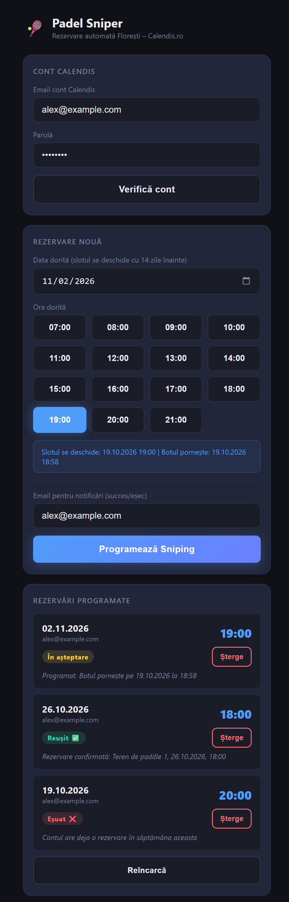
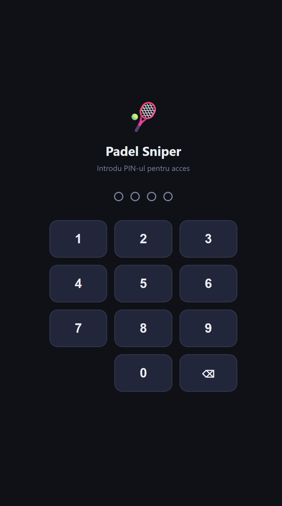

# Padel Sniper 🎾

[](https://github.com/AlexandruCiornai/Padel-Sniper/actions/workflows/tests.yml)

The padel courts in my town (Parcul Sportiv Florești, booked through Calendis) open for booking exactly 14 days ahead, and the evening slots are gone within seconds. So I built a bot that books them the moment they open.

You pick a date and time on your phone. The bot logs in two minutes early, waits on the calendar page, and clicks the slot at exactly `hh:mm:00`. Then it emails you whether it worked.

<p align="center">
  
  &nbsp;&nbsp;
  
</p>
<p align="center"><sub>The phone UI (in Romanian), shown with sample data.</sub></p>

## How it works

```
 phone ──► Flask app (PIN-protected) ──► SQLite (scheduled bookings)
                 │
                 └─► APScheduler: fire at (slot time − 14 days − 2 min)
                          │
                          ▼
                 Playwright (headless Chromium)
                   1. log in to Calendis, check the weekly booking limit
                   2. open the court calendar on the target day
                   3. wait in 100 ms steps until hh:mm:00
                   4. wait for the slot to appear in the DOM, then click it
                          │
                          ├─► live status to the phone over Socket.IO
                          └─► result email over Gmail SMTP
```

- **Timing:** the job starts 2 minutes early so that login and page load happen before the slot opens. At the exact second, it only has to wait for the slot element and click it.
- **Verify before you sleep:** "Check account" does a real login right away. That way, wrong credentials show up today instead of two weeks later at 15:00.
- **Live feedback:** each step is pushed to the open page over Socket.IO and saved to SQLite, so the status survives a page reload.
- **Access control:** the app sits behind a PIN with per-IP lockout (5 wrong attempts lock that IP for 15 minutes). The app refuses to start without a valid PIN and a secret key.
- **DST-safe timing:** "14 days before" is computed in calendar days on the Bucharest clock, so a slot on 2 November still fires at 19:00 on 19 October, even though the clocks change in between.
- **Tested core:** the booking rules (slot parsing, opening time, bot start time, PIN rules) live in [`core.py`](core.py), separate from Flask and Playwright. That way they're unit tested on every push across Python 3.11–3.13, including both DST changes.

## Stack

Python · Flask · Flask-SocketIO (eventlet) · APScheduler · Playwright · SQLite · Gmail SMTP · deployed on Railway

## Run it locally

```bash
pip install -r requirements.txt
playwright install chromium --with-deps
cp .env.example .env      # fill in SECRET_KEY, APP_PIN, GMAIL_USER, GMAIL_PASS
python app.py             # http://localhost:5000
```

| Variable | What it is |
|---|---|
| `SECRET_KEY` | Flask session key. Required. Generate one with `openssl rand -hex 32`. |
| `APP_PIN` | The 4-digit PIN for opening the app. Required. |
| `GMAIL_USER` / `GMAIL_PASS` | The Gmail account and [app password](https://support.google.com/accounts/answer/185833) used for result emails. If these are empty, no emails are sent. |
| `PORT` | Defaults to 5000. |

Deploying to Railway: [`railway.json`](railway.json) installs Chromium during the build. The step-by-step guide (in Romanian) is in [SETUP.md](SETUP.md).

## Tests

```bash
pip install -r requirements-dev.txt
pytest -v
```

The tests are in [`tests/test_core.py`](tests/test_core.py). They pin down the DST case behind a bug I fixed in the phone UI, where the "slot opens at" hint was an hour off whenever the clocks changed inside the 14 days.

## Limitations and what I'd do next

- The Calendis password is stored in plain text in SQLite until the booking runs, because the bot has to log in on its own. Next step: encrypt it at rest with a key from the environment, and delete it once the booking finishes.
- Scheduled jobs live in memory, so a restart loses them. Next step: re-schedule pending bookings from SQLite at startup.
- The CSS selectors are tied to the current Calendis markup and will break if the site changes.
- This was built for my own bookings. Use it within the booking site's terms.
